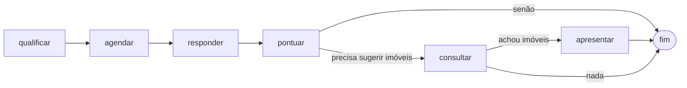

# solar-ai

[](https://github.com/fvconde/solar-ai/actions/workflows/ci.yml)

Agente conversacional do **Solar**, um SDR imobiliário com IA. Aqui vive a **Lia**, a corretora virtual: ela conversa com o lead, extrai o perfil (intenção, orçamento, quartos, bairros, urgência), pontua a maturidade de 0 a 100, recomenda imóveis por busca híbrida (filtros + similaridade vetorial) e decide o próximo passo (seguir conversando, agendar, encaminhar ou encerrar).

O agente é **stateless**: não acessa banco. A API ([solar-ai-api](https://github.com/fvconde/solar-ai-api)) envia o histórico e o perfil em cada `POST /turn` e guarda o resultado.

| Repositório | Papel |
|---|---|
| [solar-ai-front](https://github.com/fvconde/solar-ai-front) | Chat do lead e painel do corretor (Angular) |
| [solar-ai-api](https://github.com/fvconde/solar-ai-api) | API, banco e regras de negócio (.NET) |
| **solar-ai** | Agente da Lia (Python, LangGraph, Gemini) |

**Stack:** Python 3.12 · FastAPI · LangGraph · Gemini (`gemini-3.5-flash-lite` e `gemini-embedding-001`) · Pydantic v2 · pytest

---

## Rodar localmente

### Pré-requisitos

- Uma chave da API do Gemini ([Google AI Studio](https://aistudio.google.com/apikey))
- Docker **ou** Python 3.12

### 1. Configurar o `.env`

```bash
cp .env.example .env
```

Preencha `GEMINI_API_KEY`. Os demais valores já vêm com o padrão certo.

### 2. Subir

**Sistema completo (recomendado):** o agente sobe junto com o Postgres e a API pelo `docker compose` do [solar-ai-api](https://github.com/fvconde/solar-ai-api#rodar-localmente). Clone os dois repositórios lado a lado e siga o README de lá.

**Só o agente, com Docker:**

```bash
docker compose up --build
```

**Só o agente, sem Docker:**

```bash
python -m venv .venv
source .venv/bin/activate        # Windows: .venv\Scripts\Activate.ps1
pip install -r requirements.txt -r requirements-dev.txt
uvicorn app.main:app --port 8000 --reload
```

O agente responde em http://localhost:8000 (`/health` para status, `/docs` para o Swagger).

---

## Testes

```bash
pytest            # testes determinísticos, sem chamar o Gemini
pytest -m llm     # testes que chamam o Gemini de verdade (gastam cota)
```

---

## Como funciona

O turno é um grafo LangGraph (`app/lia/grafo.py`):



| Nó | O que faz |
|---|---|
| `qualificar` | Compara o perfil com a régua de qualificação e lista o que falta perguntar |
| `agendar` | Coloca no prompt os horários livres enviados pela API |
| `responder` | Chamada ao Gemini com saída estruturada: fala da Lia, campos extraídos, próxima ação |
| `pontuar` | Recalcula o score (0–100) pela régua determinística |
| `consultar` | Busca no acervo de 80 imóveis: filtros duros + similaridade por cosseno |
| `apresentar` | Segunda chamada ao Gemini: apresenta os imóveis com o motivo de cada um |

Os embeddings do acervo ficam em cache em `data/embeddings.json`, então o boot não gasta cota. Se `data/imoveis.json` mudar, regenere com `python scripts/gerar_embeddings.py`.

## Privacidade

- Antes de qualquer texto ir ao Google (geração e embedding), CPF, telefone, e-mail e CEP são trocados por marcadores (`[CPF_1]`, `[TELEFONE_1]`…) e restaurados na resposta (`app/lia/mascaramento.py`).
- Telefone e e-mail do lead nem existem no contrato `POST /turn`: ficam só na API.
- O contrato (`app/contrato.py`) recusa campos desconhecidos e é espelhado na API .NET.
